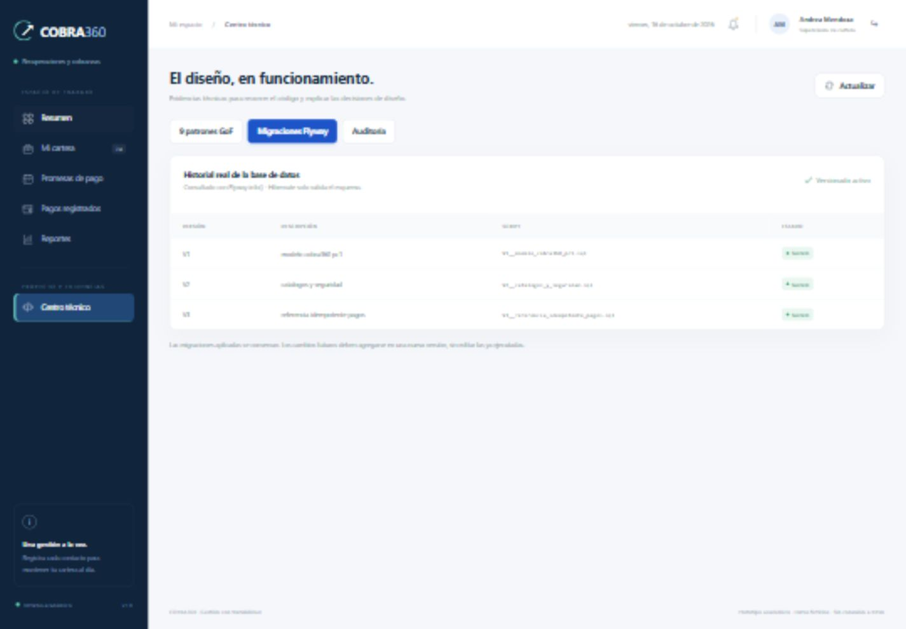

# COBRA360 · PC2

Repositorio: [Miko19-C/COBRA360](https://github.com/Miko19-C/COBRA360). La carpeta `COBRA360` contiene el proyecto completo; ejecuta los comandos desde ella.

Aplicación web de seguimiento de cobranzas y promesas de pago. Proyecto académico de Diseño de Patrones, UTP. Datos ficticios; caso de estudio basado en el contexto de BBVA.



## Organización del proyecto

```text
COBRA360/
├── backend/                     Spring Boot, API, dominio, adaptadores y pruebas
│   ├── pom.xml
│   └── src/
│       ├── main/java/pe/edu/utp/cobra360/
│       │   ├── web/             Controladores HTTP por funcionalidad
│       │   ├── application/     Casos de uso por módulo
│       │   ├── domain/          Entidades, reglas, patrones y puertos
│       │   └── infrastructure/  JPA, JDBC, seguridad, Flyway y proveedores
│       ├── main/resources/
│       │   ├── application.yml
│       │   └── db/migration/    V1, V2 y V3 de Flyway
│       └── test/java/           Integración, patrones y arquitectura
├── frontend/                    Interfaz independiente del código Java
│   ├── index.html
│   ├── styles.css
│   ├── src/
│   │   ├── main.js              Punto de entrada
│   │   ├── core/                Estado, formato e iconos
│   │   ├── services/            Cliente HTTP y carga de datos
│   │   ├── controllers/         Sesión, navegación y eventos
│   │   ├── components/          Tablas, formularios y elementos reutilizables
│   │   └── views/               Resumen, cartera, promesas, pagos y reportes
│   └── scripts/                 Desarrollo local y verificación
├── docs/                        UML, alcance, API y sustentación
├── scripts/                     Smoke test y empaquetado
├── compose.yaml                 MySQL 8.0.44 aislado en puerto 3308
├── pom.xml                      Agregador Maven del proyecto
└── mvnw / mvnw.cmd               Maven Wrapper
```

La arquitectura es un **monolito modular por capas y funcionalidades**. Los controladores llaman casos de uso; los casos de uso dependen de puertos de dominio; infraestructura implementa esos contratos. SQL, repositorios concretos y composición de proveedores permanecen en infraestructura.

El frontend tiene una sola fuente en `frontend/`. Maven lo incorpora al ejecutable para la demostración. También puede ejecutarse en un proceso independiente durante desarrollo.

## Inicio rápido · una aplicación

Requisitos: Java 17 y Docker Desktop iniciado. Maven se descarga automáticamente con el wrapper. Este modo no necesita Node.

```powershell
docker compose up -d --wait
.\mvnw.cmd -pl backend spring-boot:run "-Dspring-boot.run.profiles=demo"
```

Abre **http://127.0.0.1:8080**. También puedes ejecutar `./iniciar.ps1`, que carga un `.env` local si existe y luego arranca MySQL y el módulo backend.

Flyway crea las diez tablas originales, las extensiones técnicas y los catálogos. Hibernate utiliza `ddl-auto=validate`. El perfil `demo` incorpora datos ficticios cuando `cliente` está vacía; los reinicios conservan el trabajo.

## Desarrollo con frontend separado

Mantén el backend ejecutándose y abre otra terminal. Requiere Node 20 o superior.

```powershell
npm --prefix frontend run dev
```

Abre **http://127.0.0.1:5173**. El servidor local sirve los archivos de `frontend/` y redirige `/api` a Spring Boot en 8080. Conserva las cookies de sesión y CSRF. No requiere instalar paquetes npm.

Consulta [frontend/README.md](frontend/README.md) para conocer las responsabilidades de cada módulo y [backend/README.md](backend/README.md) para las capas y reglas de negocio.

## Usuarios de demostración

Contraseña: **`Cobra360!2026`**.

| Usuario | Perfil | Alcance |
|---|---|---|
| `supervisor` | Supervisor | Todas las carteras, asignación, auditoría, Flyway y patrones. |
| `mirko` | Asesor junior | Cartera de mora temprana asignada. |
| `lucia` | Asesora semi senior | Cartera de mora tardía asignada. |
| `diego` | Asesor senior | Cartera de mora castigo asignada. |

La instalación inicial contiene 24 deudas, 12 promesas de estados distintos y pagos de ejemplo. Si presentas en otro día, usa **Supervisor → Mi cartera → Asignar cartera** para generar las asignaciones de esa fecha.

## MySQL y configuración

MySQL de Docker escucha en **127.0.0.1:3308**, separado de otros MySQL del equipo. Base: `cobra360`; usuario local: `cobra360`; contraseña local: `cobra360_local`. Puedes conectarte desde Workbench.

Las variables están en `.env.example`. Docker Compose carga `.env`; `iniciar.ps1` también las incorpora al proceso de Spring Boot. Si ejecutas Maven manualmente, configura las variables en la terminal cuando necesites otros valores.

Usa una base vacía al instalar. No ejecutes el `DROP DATABASE` de la PC1 sobre este entorno. Flyway conserva su historial y rechaza esquemas anteriores sin migraciones reconocidas.

## Verificación y ejecutable

```powershell
# Backend completo: integración con MySQL temporal y reglas de arquitectura.
.\mvnw.cmd verify

# Frontend: sintaxis, imports/exports y dependencias sin ciclos.
npm --prefix frontend run check
npm --prefix frontend test

# Ejecutable después de la compilación.
java -jar backend/target/cobra360-1.0.0.jar --spring.profiles.active=demo

# Comprobación HTTP sobre la aplicación ya iniciada.
.\scripts\smoke-test.ps1
.\scripts\verificar-roles.ps1 -BaseUrl http://127.0.0.1:8080
```

Las pruebas de integración usan un MySQL temporal con Testcontainers, independiente de los datos demo. Resultados: `backend/target/surefire-reports`. La automatización en GitHub verifica backend y frontend.

Para ejecutar únicamente patrones y arquitectura, sin contenedor:

```powershell
.\mvnw.cmd -pl backend "-Dtest=PatronesTest,ArquitecturaTest" test
```

Detén la aplicación con `Ctrl+C`; `docker compose stop` conserva el volumen MySQL. Para generar el ZIP de código, ejecuta `./scripts/empaquetar.ps1`.

## Funcionalidades

- Cartera diaria con búsqueda, filtros, paginación e indicadores.
- Registro tipificado de contacto e historial del cliente.
- Teléfonos con estado y bloqueo de números errados/fuera de servicio.
- Promesas con importe y fecha validados.
- Pagos parciales/completos y actualización transaccional de saldos.
- Asignación por tramo y perfil, sin duplicación diaria.
- Reportes, exportación CSV, auditoría y evidencias de nueve patrones.
- Core bancario simulado con referencia idempotente; notificación interna auditada.

## Material para la rúbrica PC2

- [Estructura y correspondencia con los cinco criterios](docs/ESTRUCTURA_PC2.md).
- [Arquitectura, modelo y SOLID](docs/ARQUITECTURA.md).
- [Nueve patrones y diagramas UML](docs/PATRONES.md).
- [API y CSRF](docs/API.md).
- [Alcance implementado y pendientes](docs/ALCANCE_PC2.md).
- [Guion de sustentación de 15 minutos](docs/SUSTENTACION.md).
- [Verificación realizada](docs/VERIFICACION.md).
- [Errores encontrados y corregidos](docs/REVISION_ERRORES.md).

La entrega formal también requiere publicar el repositorio con acceso al docente, preparar Word/PDF y siete diapositivas, incorporar evidencias y ensayar. Las metas de mejora del negocio propuestas en PC1 requieren validación con usuarios; el prototipo no las presenta como resultados medidos.
