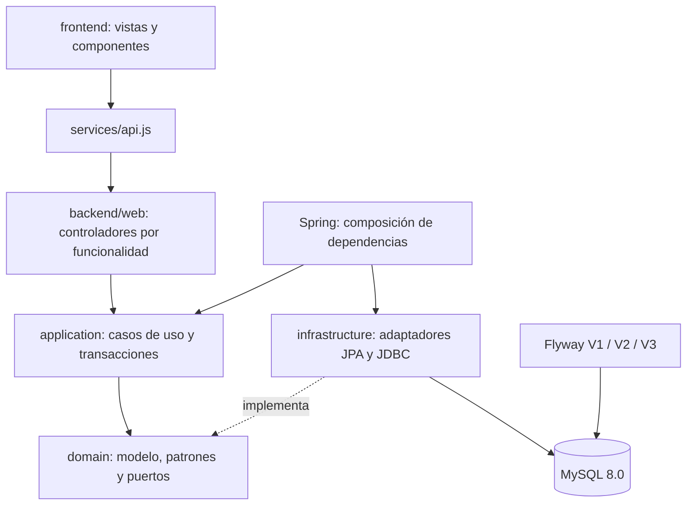
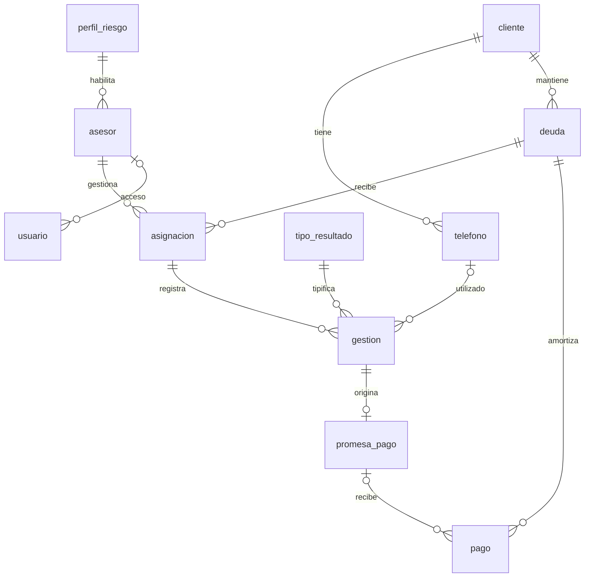

# Arquitectura de COBRA360

## Organización y decisiones

El repositorio separa `backend`, `frontend` y `docs`. El backend es un monolito modular con capas y paquetes funcionales; el frontend utiliza módulos ES por responsabilidad y pantallas. Maven actúa como agregador y empaqueta la interfaz para una demostración de un solo proceso. El servidor de desarrollo de la interfaz permite trabajar en 5173 con la API en 8080.

Se conservan los actores, las diez entidades y las tres pantallas centrales aprobadas en PC1. Los IDs se implementan como `BIGINT`/`Long`, con tablas técnicas de usuarios y auditoría y una referencia externa en pagos.

## Dirección de dependencias

- **Web → aplicación:** los controladores validan la entrada y solicitan casos de uso. No ejecutan SQL ni consultan Flyway directamente.
- **Aplicación → dominio:** los servicios reciben interfaces de repositorios, identidad, auditoría, notificaciones, consultas e indicadores.
- **Infraestructura → contratos:** JPA, JDBC, Spring Security y Flyway implementan las interfaces que consume la aplicación.
- **Dominio:** no depende de aplicación, web ni infraestructura. Las entidades conservan anotaciones JPA; los puertos son independientes de frameworks.

`ArquitecturaTest` verifica estas fronteras sobre bytecode, incluyendo la ausencia de ciclos entre los módulos de aplicación. La documentación describe una arquitectura por capas con puertos e inversión de dependencias; el modelo con JPA es una decisión explícita.

## Módulos y controladores

| Funcionalidad | Controlador | Servicios principales |
|---|---|---|
| Sesión | `SessionController` | `AccesoService` → `UsuarioSesionPort`. |
| Cartera | `CarteraController` | `CarteraQueryService`, `AsignacionService`. |
| Gestión | `GestionController` | `CobranzaFacade`, `RegistroGestionService`, `PlantillaGestionService`. |
| Promesas | `PromesaController` | Consulta autorizada y `SeguimientoPromesaService`. |
| Pagos | `PagoController` | `RegistroPagoService`, `ConciliacionPagoService`. |
| Reportes | `ReporteController` | `ReporteService`. |
| Evidencias | `TecnicoController` | `PatronesService`, `VerificacionTecnicaService`. |

El job `PromesasVencidasJob` pertenece a infraestructura y programa la ejecución del caso de uso de seguimiento. El backend no depende de archivos ni módulos JavaScript; la incorporación de assets al JAR es una decisión de empaquetado Maven.

## Modelo relacional

`auditoria` registra usuario, acción, detalle y hora. `flyway_schema_history` es una tabla técnica de Flyway.

## Integridad y transacciones

- Asignación diaria única por deuda y fecha.
- Una promesa como máximo por gestión.
- Referencia externa de abono única.
- Restricciones PK, FK, UNIQUE y CHECK.
- Bloqueos pesimistas en orden deuda → asignación/promesa para serializar pagos y evitar sobregiros.
- La fachada confirma contacto, teléfono, promesa, notificación interna y auditoría como una unidad transaccional.
- Java utiliza `Clock` de Lima, importes `BigDecimal` y columnas `DECIMAL(12,2)`; SQL usa `-05:00`.
- Los datos de negocio se conservan; la interfaz no incluye borrado de operaciones.

## Estados de promesa

1. Si los pagos vinculados alcanzan el compromiso: `CUMPLIDA`.
2. Si falta importe y la fecha comprometida pasó: `INCUMPLIDA`.
3. Si hay abonos y aún no venció: `PARCIAL`.
4. Si no hay abonos y no venció: `PENDIENTE`.

La consulta obtiene el estado vigente aunque el proceso nocturno no haya corrido. El job diario a las 00:05 también persiste compromisos incumplidos. El cumplimiento actual se mide por importe; el análisis separado de puntualidad es una ampliación posible.

## SOLID

| Principio | Evidencia |
|---|---|
| SRP | Registro, pago, conciliación, seguimiento, consultas, reportes, acceso y auditoría tienen responsabilidades y servicios separados. |
| OCP | Notificación, core y consultas se sustituyen mediante contratos; los decoradores añaden responsabilidades por composición. |
| LSP | Las familias de cobranza y los notificadores mantienen contratos comunes. |
| ISP | Puertos de lectura y escritura específicos; identidad, migraciones, auditoría y notificación son contratos distintos. |
| DIP | Aplicación depende de puertos. Infraestructura ensambla implementaciones y decoradores. |

Las reglas de actualización de teléfonos se mapean por resultado; una nueva tipificación que cambie ese comportamiento requiere ampliar su mapeo. Las políticas de las tres familias comparten límites de importe/fecha y mensajes específicos; no se implementan descuentos oficiales.

## Sesión y alcance

BCrypt, cookie HttpOnly/SameSite=Strict, sesión de 30 minutos y CSRF habilitado. Spring Security restringe roles en las rutas; los casos de uso validan propiedad de cartera. Los datos y las credenciales demo son ficticios y locales. No hay integración real con BBVA ni mensajería externa.

## Migraciones reproducibles

| Versión | Contenido |
|---|---|
| V1 | Modelo de diez entidades, índices, restricciones y vista. |
| V2 | Catálogos, usuarios y auditoría. |
| V3 | Referencia externa idempotente de pagos. |

Flyway es el único creador del esquema; Hibernate valida. Reorganizar las carpetas no cambió los scripts aplicados ni sus checksums. Los fixtures de demo se generan en Java para fechas relativas y BCrypt.
