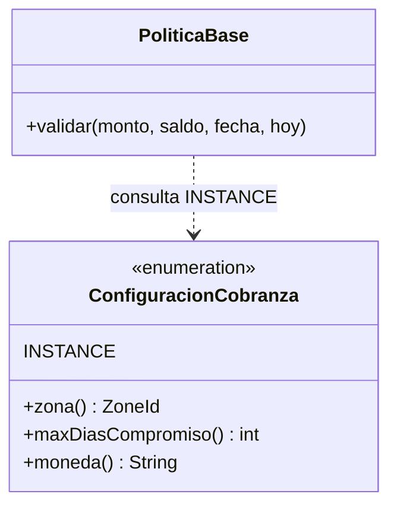
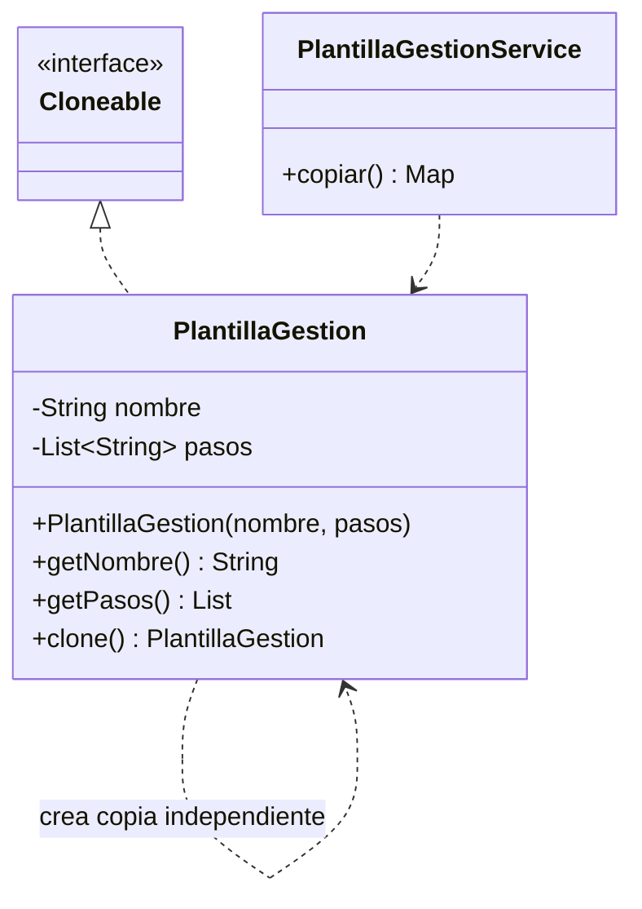
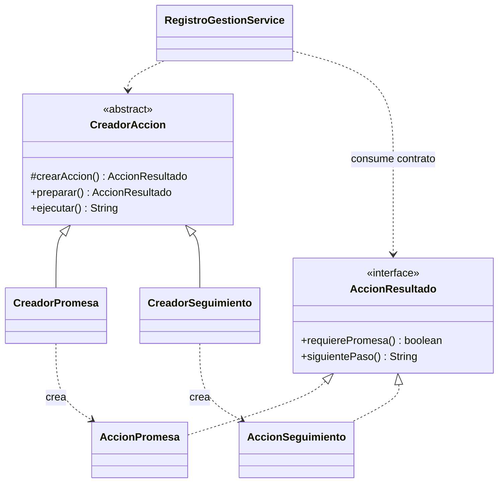
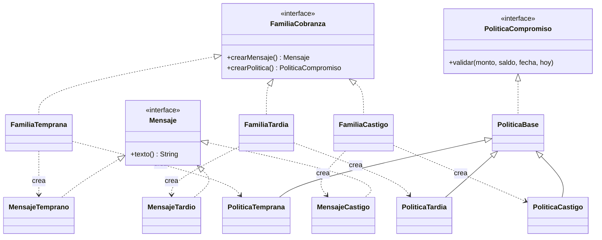
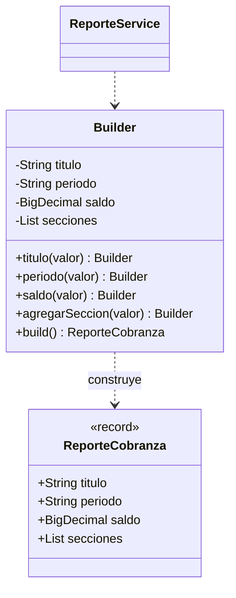
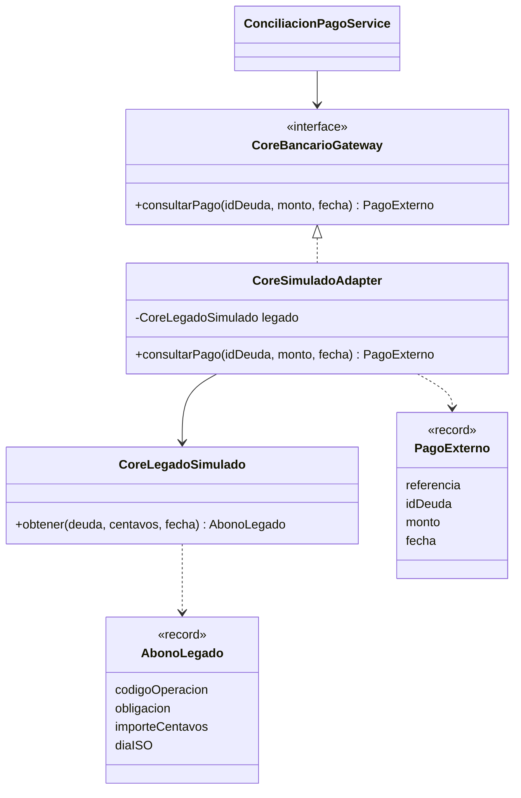
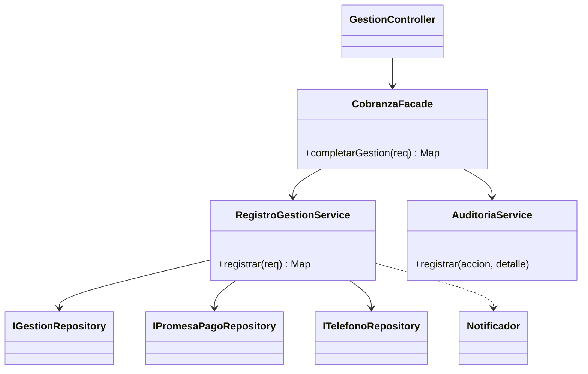
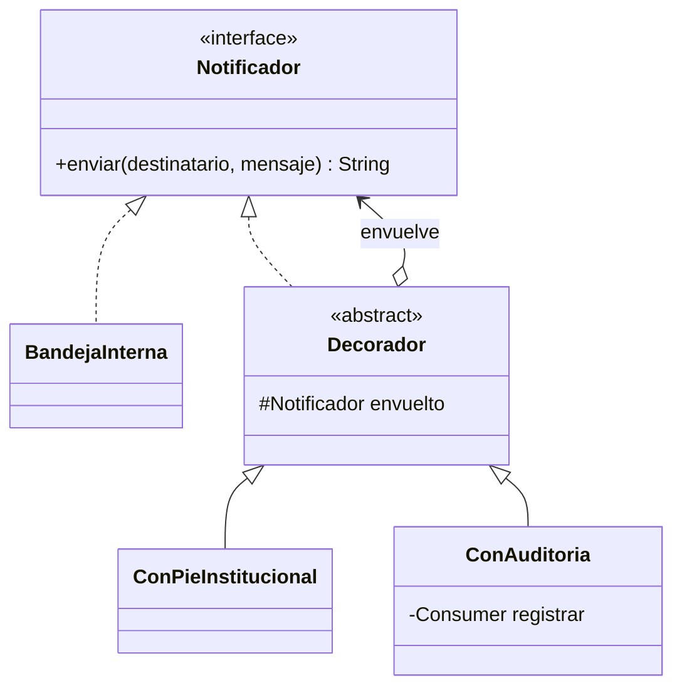
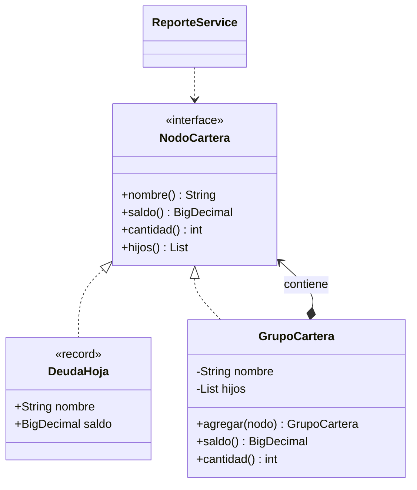

# Los nueve patrones de COBRA360

Los nombres de estos diagramas corresponden al código. Varias clases pequeñas se declaran como clases anidadas públicas dentro del archivo indicado; eso no cambia sus roles GoF. El centro técnico ejecuta las evidencias del servidor y permite inspeccionar sus resultados.

Las rutas Java indicadas son relativas a `backend/src/main/java/pe/edu/utp/cobra360/`. Los servicios están en subpaquetes de `application` por funcionalidad. La interfaz independiente se encuentra en `frontend`.

## 1. Singleton — configuración de cobranza

**Archivo:** `domain/patterns/ConfiguracionCobranza.java`.

**Problema:** el límite de días de compromiso, la moneda y la zona deben tener una referencia central coherente. **Implementación:** un `enum` con un único miembro `INSTANCE`. `FamiliaCobranza.PoliticaBase` consulta su límite de 90 días para validar promesas.

**Demostración:** Centro técnico → Singleton; luego intentar una fecha de compromiso fuera del límite. **Ventaja:** instancia única y seguridad frente a serialización. **Costo:** configuración global y fija durante la ejecución; para políticas distintas por organización convendría un servicio configurable.

No se implementa un singleton manual para conexiones: HikariCP gestiona un pool. Un bean singleton de Spring es único por contenedor; el `enum` presentado es la implementación explícita del patrón.

## 2. Prototype — copia independiente del guion

**Archivo:** `domain/patterns/PlantillaGestion.java`.

**Problema:** partir de un guion base y personalizarlo sin modificar el original. **Implementación:** `clone()` construye otra plantilla con una nueva lista de pasos. Los pasos son `String` inmutables; copiar la colección es suficiente para independizar este modelo.

**Demostración:** Gestionar → Usar copia de guion base. La observación recibe la copia editable. En Centro técnico se agrega un paso a una copia y el original mantiene sus tres pasos.

**Ventaja:** reutiliza configuración inicial. **Costo:** si se añaden elementos mutables dentro de la lista habrá que copiarlos también. Nunca se duplican IDs de gestiones persistidas ni promesas de pago.

## 3. Factory Method — acción por resultado

**Archivo:** `domain/patterns/CreadorAccion.java`.

**Problema:** tratar las acciones mediante un contrato sin acoplar el flujo a sus productos concretos. **Implementación:** el creador abstracto declara `crearAccion()`; `CreadorPromesa` y `CreadorSeguimiento` lo sobrescriben. El servicio llama `preparar()` y usa el producto `AccionResultado` para determinar si debe validar/crear una promesa y cuál es el siguiente paso.

**Demostración:** guardar una gestión “Acepta pagar” frente a una gestión “No contesta”. Una crea compromiso; la otra registra seguimiento. El catálogo decide qué creador corresponde.

**Ventaja:** construcción encapsulada y productos intercambiables. **Costo:** más tipos que una creación directa. La selección del creador sigue siendo una decisión del caso de uso; el método fábrica no elimina toda selección.

## 4. Abstract Factory — familias por tramo

**Archivo:** `domain/patterns/FamiliaCobranza.java`.

**Problema:** mantener juntos el mensaje de orientación y la política de compromiso del tramo de una deuda. **Implementación:** `FamiliaCobranza` crea dos productos abstractos, `Mensaje` y `PoliticaCompromiso`. Hay familias temprana, tardía y castigo con pares de productos correspondientes.

**Demostración:** abrir deudas de diferentes tramos y observar su guía; crear una promesa y mostrar la política de esa familia. Centro técnico expone los tipos concretos.

**Ventaja:** evita combinar por accidente mensaje de un tramo con política de otro. **Costo:** ampliar la familia de productos exige actualizar todas las fábricas. En este prototipo las tres políticas heredan los mismos límites de importe/fecha; los mensajes varían. No se afirman condiciones de negociación oficiales ni descuentos automáticos.

Factory Method crea un producto mediante un método sobrescrito en una jerarquía. Abstract Factory define una familia de varios productos relacionados. Se presentan ambos porque la rúbrica PC2 los enumera por separado.

## 5. Builder — reporte configurable e inmutable

**Archivo:** `domain/patterns/ReporteCobranza.java`.

**Problema:** construir reportes con título, periodo, saldo y secciones opcionales sin un constructor posicional difícil de leer. **Implementación:** `ReporteCobranza.Builder` acumula pasos y `build()` produce un `record` con `List.copyOf`.

**Demostración:** Reportes; mostrar `ReporteService.construir()`. **Ventaja:** construcción legible, reporte terminado inmutable. **Costo:** objeto constructor adicional. El builder es manual, no una anotación de Lombok.

`Builder` es la clase anidada `ReporteCobranza.Builder`.

## 6. Adapter — contrato de abono legado

**Archivos:** `domain/ports/CoreBancarioGateway.java` e `infrastructure/core/CoreSimuladoAdapter.java`.

**Problema:** un contrato legado entrega obligación numérica, importe en centavos y fecha ISO; el dominio necesita un `PagoExterno` con `BigDecimal` y `LocalDate`. **Implementación:** el adaptador implementa el puerto y traduce el contrato del `CoreLegadoSimulado`.

**Demostración:** como supervisor, registrar pago marcando “Usar el contrato del core simulado”. La referencia comienza con `SIM-`. Un intento idéntico se rechaza como duplicado. Centro técnico muestra la conversión de S/ 125.50 a partir de centavos.

**Ventaja:** el controlador trabaja con el puerto del dominio. **Costo:** el adaptador debe mantenerse si cambia el contrato externo. Es una simulación local, sin acceso real a BBVA.

## 7. Facade — completar gestión

**Archivo:** `application/gestion/CobranzaFacade.java`.

**Problema:** la interfaz no debe coordinar llamadas separadas para contacto, teléfono, compromiso y notificación. **Implementación:** una operación pública `completarGestion` delega el caso de uso y registra su confirmación. La operación y el servicio delegado comparten una transacción.

**Demostración:** guardar una gestión con promesa y revisar la cartera, el compromiso y Auditoría. **Ventaja:** un punto de entrada para un flujo complejo y confirmación atómica. **Costo:** requiere evitar que la fachada se convierta en una clase con toda la lógica; la lógica permanece en sus servicios.

El centro técnico describe cómo reproducir el caso real; su tarjeta de Facade no pretende simular por sí sola una escritura de negocio.

## 8. Decorator — notificación enriquecida

**Archivo:** `infrastructure/notifications/Notificadores.java`.

**Problema:** añadir pie institucional y auditoría a un notificador sin modificar su implementación base. **Implementación:** todos comparten `Notificador.enviar`. `Decorador` mantiene un componente envuelto; `ConPieInstitucional` modifica el mensaje y `ConAuditoria` registra el resultado.

La cadena se ensambla en `infrastructure/notifications/NotificacionConfig`. El servicio de gestión recibe `Notificador` por inyección; no construye ni importa los decoradores concretos.

**Demostración:** crear una promesa y revisar el evento “Decorator · Notificación interna”. En Centro técnico puede verse otra composición sin efectos persistentes.

**Ventaja:** responsabilidades combinables mediante composición. **Costo:** el orden de envoltura influye en el resultado. La base es una bandeja interna, no un canal de entrega externo.

## 9. Composite — cartera como árbol

**Archivo:** `domain/patterns/NodoCartera.java`.

**Problema:** calcular saldos/cantidades de una deuda, un tramo o toda la cartera con el mismo contrato. **Implementación:** `DeudaHoja` y `GrupoCartera` implementan `NodoCartera`; el grupo contiene nodos y suma sus resultados recursivamente.

**Demostración:** Reportes y Centro técnico → Composite. La prueba unitaria incluye un grupo dentro de otro grupo, demostrando composición recursiva y no solo agrupación SQL.

**Ventaja:** tratamiento uniforme de hojas y grupos. **Costo:** para este volumen de datos se construye el árbol en memoria; una cartera masiva exigiría paginación y agregación optimizada.

